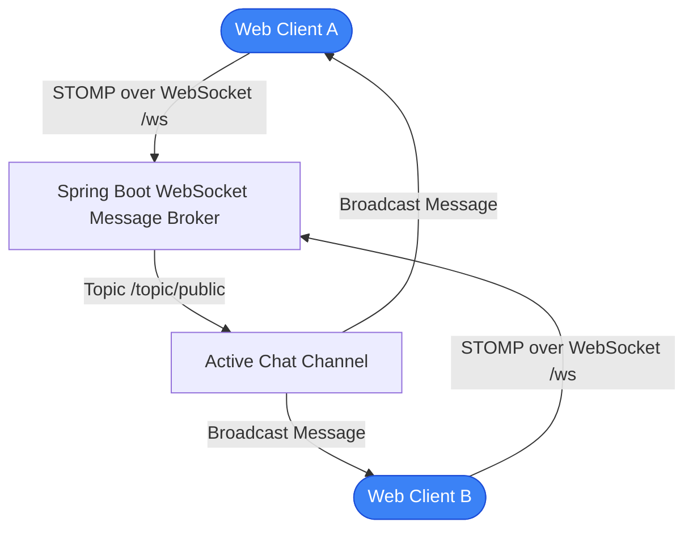

# ChatApp — Real-Time WebSocket Messaging Application with Spring Boot

> A cloud-native real-time messaging application engineered with Java 17, Spring Boot 3, STOMP/WebSocket full-duplex communication, Docker containerization, and Kubernetes deployment manifests.

[](https://www.oracle.com/java/)
[](https://spring.io/projects/spring-boot)
[](https://www.docker.com/)
[](https://kubernetes.io/)

---

## Executive Overview

ChatApp (`Cloud-AAT`) is an enterprise-pattern distributed messaging application designed to demonstrate scalable, full-duplex client-server communication. Built on the Spring Boot WebSocket framework utilizing the Simple Text Oriented Messaging Protocol (STOMP), it enables real-time broadcast chat channels, user presence notifications, and sub-millisecond message dispatching. The application is packaged with comprehensive DevOps automation including multi-stage Docker builds, Docker Compose, Kubernetes orchestration manifests, and automated GitHub Actions deployment pipelines.

---

## Core Capabilities & Features

### Implemented Features
- **Full-Duplex Bidirectional Messaging:** Sub-millisecond text dispatching utilizing Spring STOMP messaging over standard WebSockets.
- **User Presence & Session Management:** Automated user join/leave broadcast events managed via Spring WebSocket event listeners.
- **Enterprise Containerization:** Multi-stage `Dockerfile` creating minimal, secure JRE container images.
- **Kubernetes Orchestration:** Complete `kubernetes-manifest.yaml` configuring Deployments, Services, and Horizontal Pod Autoscaling (HPA) targets.
- **Automated CI/CD:** GitHub Actions workflows (`.github/workflows/deploy.yml`) executing compilation, testing, and container publishing.

---

## System Architecture



---

## Directory Structure

```text
Cloud-AAT/
├── .github/
│   └── workflows/           # deploy.yml & docker-image.yml CI pipelines
├── src/
│   ├── main/
│   │   ├── java/com/chatapp/ # Spring Boot controllers, models, and WebSocket config
│   │   └── resources/       # Static web client (HTML, CSS, JS) and application.properties
├── Dockerfile               # Multi-stage production container build
├── docker-compose.yml       # Local multi-service orchestration
├── kubernetes-manifest.yaml # Kubernetes cluster deployment specifications
├── pom.xml                  # Maven dependencies and build plugins
├── DEPLOYMENT.md            # Comprehensive cloud deployment instructions
├── PIPELINE.md              # CI/CD pipeline architectural documentation
└── README.md                # Master repository technical documentation
```

---

## Build & Execution

### Local Maven Execution
```bash
# Clone the repository
git clone https://github.com/StratagemVX/Cloud-AAT.git
cd Cloud-AAT

# Build and run with Maven Wrapper
./mvnw clean package
./mvnw spring-boot:run
```
Web client will be accessible at: `http://localhost:8080`

### Docker Execution
```bash
docker-compose up --build
```

---

## Contributor Attribution & Profile

- **Lead Engineer:** Chethan Kumar B S (`StratagemVX`)
- **Institution:** Department of Computer Science & Engineering, MVJ College of Engineering
- **GitHub:** [https://github.com/StratagemVX](https://github.com/StratagemVX)
- **Portfolio:** [https://chethan-kumar-portfolio.vercel.app/](https://chethan-kumar-portfolio.vercel.app/)
- **LinkedIn:** [https://linkedin.com/in/chethan-kumar-b-s-781a002bb](https://linkedin.com/in/chethan-kumar-b-s-781a002bb)

## Verification and maintenance

Keep this project/profile overview synchronized with the actual repositories and current implementation.

### Verification commands

No root package manifest was available during this pass. Use each project's actual dependency manifest and CI configuration to determine appropriate verification commands.

### Contribution and security notes

- Verify repository links, project ownership, feature claims, and screenshots before publishing updates.
- Never publish credentials, private keys, personal data, or local environment files.
- Use placeholder-only configuration examples and deployment-managed secrets.
- Include reproduction steps and expected/actual behavior in issue reports.
- Run relevant checks before merging code changes.
