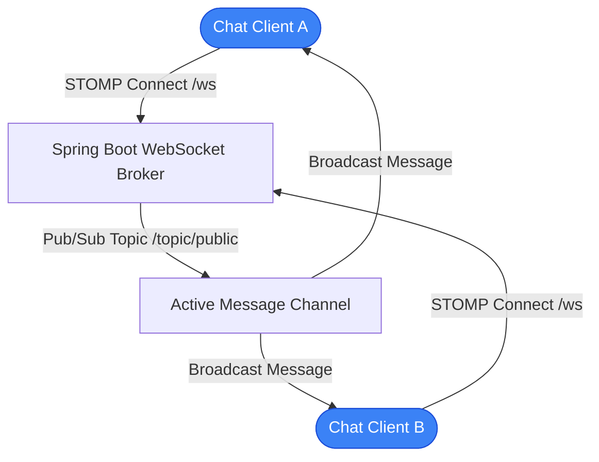

# ChatApp — Real-Time WebSocket Messaging Application with Spring Boot

> Scalable full-duplex real-time messaging application engineered with Java 17, Spring Boot, STOMP/WebSocket protocols, Docker, Kubernetes manifests, and automated CI/CD.

---

## 1. Project Title
**ChatApp** (`Cloud-AAT`) — Enterprise Real-Time Messaging Platform with Spring Boot & WebSockets.

## 2. Project Overview
ChatApp is a cloud-native messaging application built to demonstrate high-concurrency pub/sub communication patterns. Utilizing Spring Boot's WebSocket STOMP messaging broker, it enables users to join dynamic chat channels, exchange real-time text messages with sub-millisecond dispatching, and broadcast presence notifications.

## 3. Key Features
- **Full-Duplex STOMP over WebSocket:** Instant bidirectional messaging without polling overhead.
- **Cloud-Ready Containerization:** Optimized multi-stage `Dockerfile` and `docker-compose.yml`.
- **Kubernetes Orchestration:** Complete `kubernetes-manifest.yaml` specifying deployments, services, and replicas.
- **Automated CI/CD:** GitHub Actions workflows (`.github/workflows/deploy.yml`) for automated container building and testing.

## 4. Technology Stack
- **Language:** Java 17
- **Backend Framework:** Spring Boot 3.x, Spring WebSocket, Spring Messaging
- **Build Tool:** Apache Maven (`pom.xml`)
- **DevOps & Cloud:** Docker, Docker Compose, Kubernetes, GitHub Actions CI/CD

## 5. System Architecture


## 6. Build and Execution
```bash
# Clone the repository
git clone https://github.com/StratagemVX/Cloud-AAT.git
cd Cloud-AAT

# Build and run with Maven Wrapper
./mvnw clean package
./mvnw spring-boot:run

# Run with Docker
docker-compose up --build
```

## 7. Author & Project Information
- **Engineer:** Chethan Kumar B S (`StratagemVX`)
- **Institution:** MVJ College of Engineering
- **Domain:** Distributed Systems, Cloud Computing & Real-Time Architectures
