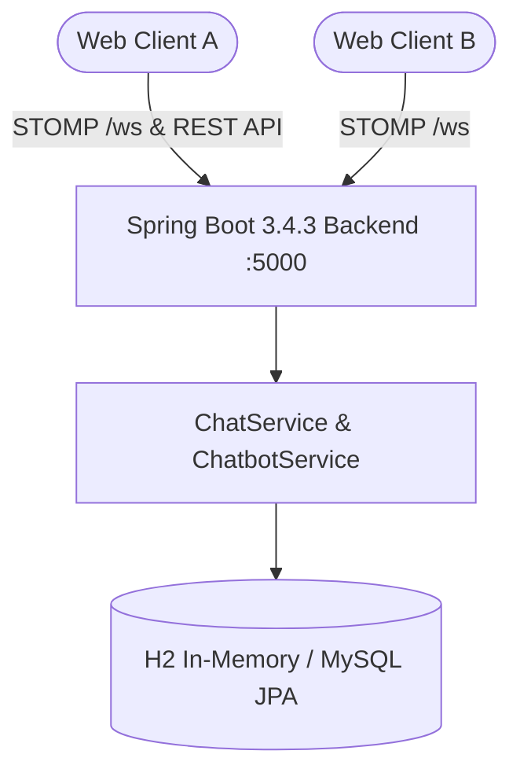

# ChatApp (`Cloud-AAT`) — Spring Boot WebSocket Messaging & FAQ Chatbot

> Full-stack real-time messaging application engineered with Java 21, Spring Boot 3.4.3, STOMP over WebSockets, H2/MySQL JPA persistence, Docker multi-stage builds, Kubernetes manifests, and GitHub Actions CI/CD.

[](https://www.oracle.com/java/)
[](https://spring.io/projects/spring-boot)
[](https://www.docker.com/)
[](https://kubernetes.io/)

---

## Executive Overview

**ChatApp** (`Cloud-AAT`) is a real-time chat and embedded FAQ chatbot application powered by **Spring Boot 3.4.3** (`pom.xml`, `<java.version>21</java.version>`). It pairs a static browser client (`src/main/resources/static/`) with Spring STOMP/WebSocket message brokering (`WebSocketConfig`, `ChatController`), REST user/history controllers (`UserController`, `ChatbotController`), TF-IDF-style FAQ matching (`ChatbotService`), and Spring Data JPA persistence backed by in-memory H2 (development) or MySQL (optional production config).

> **Security Remediation Status (`main` vs. Open Draft PR #2 — `security/escape-chat-html`):**
> - **PR #2** escapes dynamic user/message HTML in `src/main/resources/static/js/app.js`, binds WebSocket STOMP message sender identities, restricts HTTP/WebSocket CORS via `CorsOriginUtils` (`APP_CORS_ALLOWED_ORIGINS`, disallowing wildcard `*`), disables the H2 web console by default (`H2_CONSOLE_ENABLED=false`), gates administrative history reset behind `APP_ADMIN_TOKEN`, adds `SecurityHardeningTest.java`, and hardens `.github/workflows/deploy.yml`, `Dockerfile`, and `docker-compose.yml` (verified passing in GitHub Actions `CI/CD Pipeline` and `Docker Image CI`).

---

## Core Capabilities & Architecture

### Implemented Components
- **STOMP / WebSocket Chat Broker (`WebSocketConfig.java`, `WebSocketEventListener.java`, `ChatController.java`):** Full-duplex chat channel broadcasting messages and join/leave presence updates.
- **REST & Chatbot Services (`UserController.java`, `ChatbotController.java`, `ChatbotService.java`):** User registration/listing, message history retrieval, and FAQ intent response matching (`FaqEntry` / `data.sql`).
- **JPA Persistence (`application.properties`):** Configured for H2 (`jdbc:h2:mem:chatdb`, `create-drop`) in local development/testing on port `5000`, with commented MySQL connection settings for persistent deployment.
- **Container & Kubernetes Packaging:** Multi-stage `Dockerfile`, `docker-compose.yml`, `kubernetes-manifest.yaml`, `deploy.sh`, and CI workflows (`deploy.yml`, `docker-image.yml`).



---

## Directory Structure

```text
Cloud-AAT/
├── .github/workflows/
│   ├── deploy.yml                   # Maven clean verify, package, Trivy FS scan, Docker Hub push
│   └── docker-image.yml             # Docker build verification
├── src/
│   ├── main/
│   │   ├── java/com/chatapp/
│   │   │   ├── config/              # WebConfig, WebSocketConfig, WebSocketEventListener, CorsOriginUtils (PR #2)
│   │   │   ├── controller/          # ChatController, ChatbotController, UserController
│   │   │   ├── dto/                 # MessageDTO, UserDTO
│   │   │   ├── exception/           # GlobalExceptionHandler
│   │   │   ├── model/               # ChatMessage, FaqEntry, User
│   │   │   ├── repository/          # JPA repositories
│   │   │   └── service/             # ChatService, ChatbotService, UserService
│   │   └── resources/
│   │       ├── static/              # index.html, css/style.css, js/app.js
│   │       ├── application.properties
│   │       └── data.sql
│   └── test/java/com/chatapp/       # JUnit 5 / Mockito controller, DTO, model, service & security tests
├── Dockerfile
├── docker-compose.yml
├── kubernetes-manifest.yaml
├── pom.xml                          # Spring Boot 3.4.3 / Java 21 Maven manifest
├── DEPLOYMENT.md
├── PIPELINE.md
└── README.md
```

---

## Build, Execution & Configuration

### Maven Commands (`pom.xml` / `.github/workflows/deploy.yml`)
*Note: `.mvn/wrapper/maven-wrapper.jar` and a Unix `mvnw` script are not checked in; ensure Maven 3.9+ and JDK 21 are installed locally (`mvn`), or run via Docker (`docker compose up --build`).*

```bash
git clone https://github.com/StratagemVX/Cloud-AAT.git
cd Cloud-AAT

# Compile & run JUnit 5 test suite (target Java 21)
mvn clean verify

# Build executable JAR and run locally (http://localhost:5000)
mvn clean package -DskipTests
mvn spring-boot:run

# Containerized execution
docker compose up --build
```

### Runtime Environment Properties (`application.properties`, PR #2)
| Variable | Purpose | Default |
|---|---|---|
| `SERVER_PORT` / `server.port` | HTTP server port | `5000` |
| `APP_CORS_ALLOWED_ORIGINS` | Comma-separated approved CORS/WebSocket origins (PR #2) | `http://localhost:5000,http://127.0.0.1:5000,http://localhost:8080,http://127.0.0.1:8080` |
| `APP_ADMIN_TOKEN` | Admin token protecting history reset endpoints (PR #2) | Empty (fail-closed) |
| `H2_CONSOLE_ENABLED` | Toggle H2 console exposure (PR #2) | `false` |

Configure a persistent database (e.g., MySQL), `APP_CORS_ALLOWED_ORIGINS`, and `APP_ADMIN_TOKEN` through deployment environment secrets before production exposure. See `DEPLOYMENT.md` and `PIPELINE.md` for pipeline and cluster setup.

---

## Contributor Attribution & Profile

- **Lead Engineer:** Chethan Kumar B S (`StratagemVX`)
- **GitHub:** [https://github.com/StratagemVX](https://github.com/StratagemVX)
- **Portfolio:** [https://chethan-kumar-portfolio.vercel.app/](https://chethan-kumar-portfolio.vercel.app/)
- **LinkedIn:** [https://linkedin.com/in/chethan-kumar-b-s-781a002bb](https://linkedin.com/in/chethan-kumar-b-s-781a002bb)
